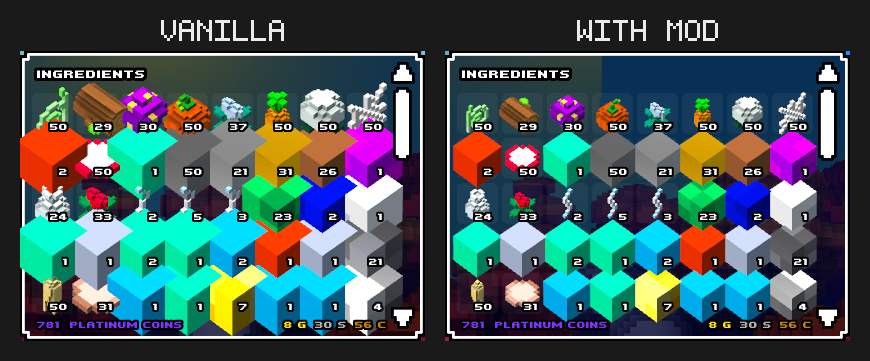

# Cube World Item Scale Mod

The game does not scale UI elements with the game resolution, but items inside
the UI are scaled. This makes items appear way too big on high resolution
displays. This mod enforces a fixed size for items that looks good on all
resolutions, so that items do not clip into their neighbours.

*In vanilla the items overflow their slots, covering the header, the scrollbar
and each other. This is an example on a 1440p monitor. 2160p is even worse.*

This mod is for the **alpha** build of Cube World.

## Installation

* requires [coremaze Cube-World-Mod-Launcher](https://github.com/coremaze/Cube-World-Mod-Launcher/releases/tag/v1.5)
* unpack Mod Launcher in the game directory
* put `ItemScaleMod.dll` into `Mods`
* start the game via `CubeModLauncher.exe`

## Compilation

Requires a compiler that targets 32-bit Windows. Due to the `asm` style, `MSVC`
will not work, use `GCC` or `Clang`. Run `make` in this directory and specify
the compiler as `CXX` variable if necessary (e.g.
`make CXX=i686-w64-mingw32-g++`).
